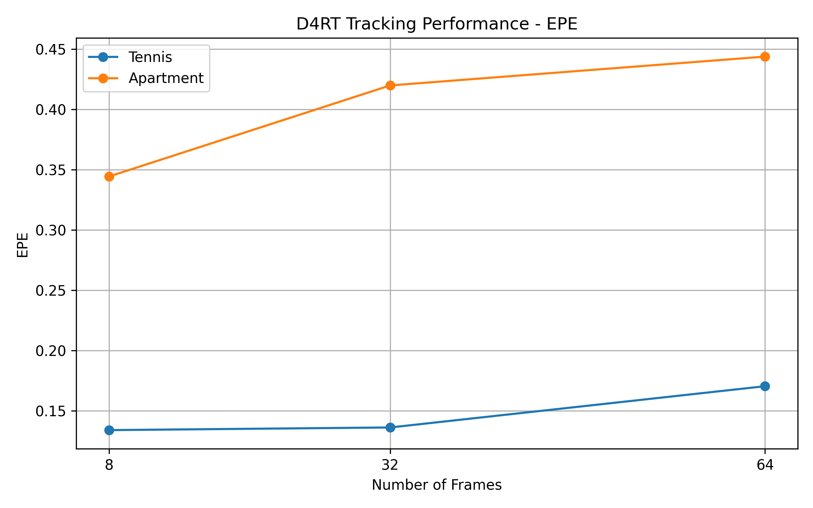

# D4RT Preliminary Evaluation - Sequence Length

## Experimental Setup
Model: Open-D4RT, 32-frame checkpoint.
Dataset: WorldTrack, one Tennis sequence (pstudio_mini) and one Apartment sequence (adt_mini).
Sequence lengths: 8, 32, and 64 frames.
Device: NVIDIA GPU (CUDA).
Metric interpretation: Higher APD is better; lower EPE is better.

## Results

| Sequence | Frames | APD (global) | EPE (global) |
|---|---:|---:|---:|
| Tennis | 8 | 0.8414 | 0.1340 |
| Tennis | 32 | 0.8283 | 0.1362 |
| Tennis | 64 | 0.7825 | 0.1704 |
| Apartment | 8 | 0.5954 | 0.3443 |
| Apartment | 32 | 0.5682 | 0.4198 |
| Apartment | 64 | 0.5429 | 0.4437 |

## Visualizations

## Observations
In both tested sequences, APD decreased and EPE increased as the evaluated sequence length increased from 8 to 64 frames. This suggests a potential limitation in longer-sequence tracking.

## Implementation Details
The model uses a 32-frame clip length. Sequences of 32 frames or fewer are processed directly. For longer sequences, the evaluated implementation selects anchor clips using _make_anchor_clip_indices and combines predictions into the output trajectory. The reported anchor_clip mode does not populate the stitching chunk diagnostics.

## Limitations of This Evaluation
Only two sequences were tested. The evaluation includes different numbers of target frames at different sequence lengths, so the observed degradation cannot be attributed solely to temporal length or anchor-clip processing. Further experiments on additional sequences and controlled comparisons are necessary.

## Preliminary Conclusion
Candidate limitation 1: Performance degradation on longer evaluated sequences. This is preliminary evidence, not a confirmed general failure mode.

## Files
- d4rt_results.csv: Numerical results.
- d4rt_apd.png: APD comparison.
- d4rt_epe.png: EPE comparison.

## Static vs Dynamic Tracking (Apartment, 64 Frames)

| Metric | Static | Dynamic |
|---|---:|---:|
| Queries | 293 | 2 |
| APD (higher is better) | 0.5406 | 0.8809 |
| EPE (lower is better) | 0.4460 | 0.1001 |

Both groups were evaluated using the same global scale alignment. Static points showed lower APD and higher EPE in this sequence. However, the dynamic group contains only two queries, so this is a preliminary observation rather than a confirmed general limitation of D4RT. Further evaluation on sequences with balanced static and dynamic queries is needed.
