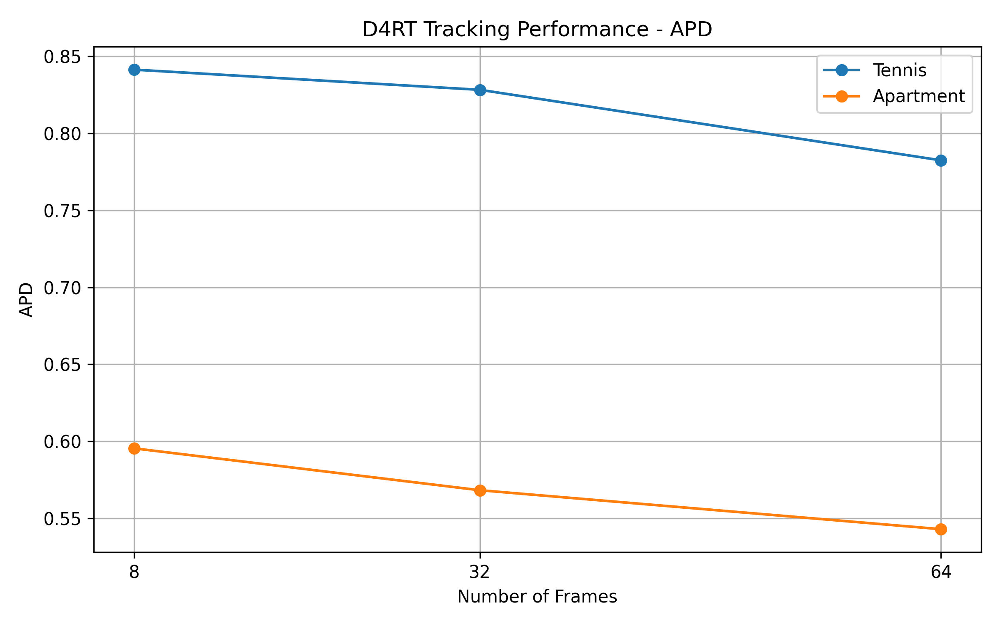
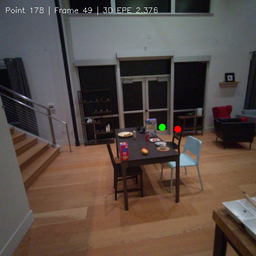
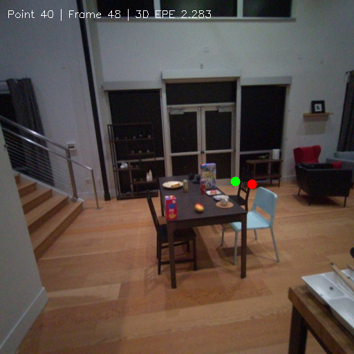
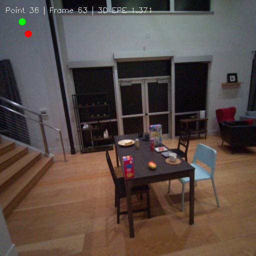

# D4RT Preliminary Evaluation - Sequence Length

## Experimental Setup
Model: Open-D4RT, 32-frame checkpoint.
Dataset: WorldTrack, one Tennis sequence (pstudio_mini) and one Apartment sequence (adt_mini).
Sequence lengths: 8, 32, and 64 frames.
Device: NVIDIA GPU (CUDA).
Metric interpretation: Higher APD is better; lower EPE is better.

## Results

| Sequence | Frames | APD (global) | EPE (global) |
|---|---:|---:|---:|
| Tennis | 8 | 0.8414 | 0.1340 |
| Tennis | 32 | 0.8283 | 0.1362 |
| Tennis | 64 | 0.7825 | 0.1704 |
| Apartment | 8 | 0.5954 | 0.3443 |
| Apartment | 32 | 0.5682 | 0.4198 |
| Apartment | 64 | 0.5429 | 0.4437 |

## Visualizations

## Observations
In both tested sequences, APD decreased and EPE increased as the evaluated sequence length increased from 8 to 64 frames. This suggests a potential limitation in longer-sequence tracking.

## Implementation Details
The model uses a 32-frame clip length. Sequences of 32 frames or fewer are processed directly. For longer sequences, the evaluated implementation selects anchor clips using _make_anchor_clip_indices and combines predictions into the output trajectory. The reported anchor_clip mode does not populate the stitching chunk diagnostics.

## Limitations of This Evaluation
Only two sequences were tested. The evaluation includes different numbers of target frames at different sequence lengths, so the observed degradation cannot be attributed solely to temporal length or anchor-clip processing. Further experiments on additional sequences and controlled comparisons are necessary.

## Preliminary Conclusion
Candidate limitation 1: Performance degradation on longer evaluated sequences. This is preliminary evidence, not a confirmed general failure mode.

## Files
- d4rt_results.csv: Numerical results.
- d4rt_apd.png: APD comparison.
- d4rt_epe.png: EPE comparison.

## Static vs Dynamic Tracking (Apartment, 64 Frames)

| Metric | Static | Dynamic |
|---|---:|---:|
| Queries | 293 | 2 |
| APD (higher is better) | 0.5406 | 0.8809 |
| EPE (lower is better) | 0.4460 | 0.1001 |

Both groups were evaluated using the same global scale alignment. Static points showed lower APD and higher EPE in this sequence. However, the dynamic group contains only two queries, so this is a preliminary observation rather than a confirmed general limitation of D4RT. Further evaluation on sequences with balanced static and dynamic queries is needed.

## Additional Failure Analysis (64 Frames)

### Apartment: Large Tracking Errors
Among 295 evaluated points, 133 had mean EPE above 0.3, 123 above 0.5, and 13 above 1.0. Median point EPE was 0.2361, while the maximum was 1.2931. This indicates substantial tracking errors for a subset of points in the Apartment sequence.

### Apartment: Temporal Error
Mean visible-point EPE increased across successive 16-frame intervals: 0.3948, 0.4118, 0.4841, and 0.6333. This is evidence of increasing tracking error within this particular sequence, but overlaps with the longer-sequence limitation.

### Occlusion Analysis
In Juggle, EPE immediately before disappearance was 0.0837 and at reappearance was 0.0831 across 14 reappearance events. In Apartment, always-visible points had EPE 0.5185 (196 points), compared with 0.3172 for 99 points occluded at least once, evaluated on visible frames. Neither comparison establishes occlusion as a failure mode.

### Interpretation
The experiments identify sequence-length degradation and substantial errors on a subset of Apartment points. Static-versus-dynamic differences remain inconclusive because only two Apartment queries were classified as dynamic. A third candidate involving spatially dependent tracking errors has been identified, although its independence and generalizability remain unconfirmed.

## Candidate Failure Case 3: Spatially Dependent Tracking Errors

In the Apartment sequence (64 frames, 295 evaluated queries), mean per-point EPE was strongly correlated with initial world-coordinate Y (r = -0.8934) and Z (r = 0.8046), but less strongly with X (r = 0.2216). Points in the higher-Z half had mean EPE 0.7144, compared with 0.1713 for the lower-Z half (approximately 4.2 times higher). Initial Y and Z were themselves correlated (r = -0.7174). These results indicate spatially concentrated tracking errors in this sequence, but do not establish a causal relationship, a camera-depth effect, or generalization to other sequences. This is a candidate failure case requiring further validation.

## Qualitative Failure Examples (Apartment, 64 Frames)

Three examples were selected from the Apartment sequence to illustrate large 3D tracking errors produced by Open-D4RT. Green markers indicate ground-truth positions, while red markers indicate predicted positions projected onto the corresponding video frames. Predictions were globally scale-aligned before evaluation.

### Example 1: Point 178, Frame 49

The predicted point is displaced to the right of its ground-truth location near the dining table. The 3D endpoint error (EPE) is **2.376**. This illustrates a substantial 3D tracking error despite a relatively small displacement in the image.

### Example 2: Point 40, Frame 48

A similar tracking discrepancy appears near the dining table. The predicted position is shifted to the right of the ground truth, with a 3D EPE of **2.283**. This provides a second example of the identified tracking inaccuracy.

### Example 3: Point 36, Frame 63

The ground-truth and predicted positions differ near the upper-left region of the image. The 3D EPE is **1.371**, showing that a relatively small 2D displacement can accompany a larger 3D error.

### Discussion

These examples illustrate large tracking errors on selected points in the Apartment sequence. The first two examples are visually similar, while the third concerns a different image region. They support the observation that tracking errors are unevenly distributed across points.

The examples were deliberately selected for high error and therefore do not represent average model performance. They demonstrate a limitation in this particular sequence, rather than establishing a general failure mode across datasets.